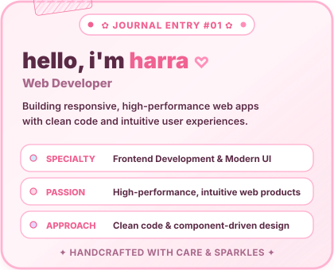
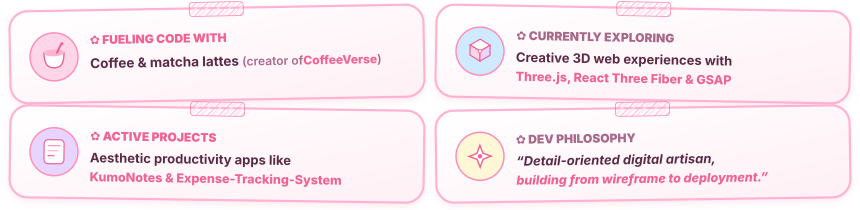
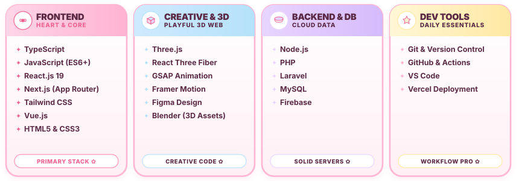
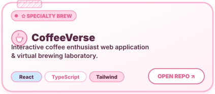
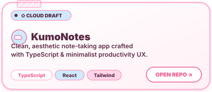
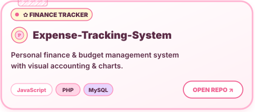
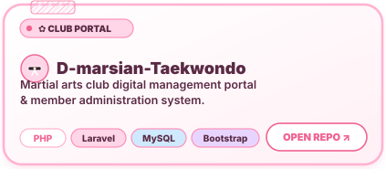
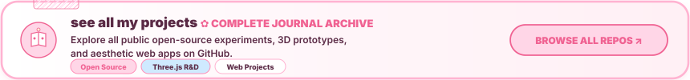

<!-- markdownlint-disable -->

  <!-- =========================================================================
       HERO BANNER: PINK CLOUD STICKER JOURNAL (Self-Contained Animated SVG)
       Features: Drifting puffy clouds, floating pastel 3D cube (Three.js/R3F nod),
       twinkling butter-yellow sparkles, washi tape pins, and cycling role line
       (first frame readable; never renders blank).
       ========================================================================= -->
  

   

  <!-- =========================================================================
       QUICK BADGES: Tightly wrapped  (Zero whitespace / no blue line glitch)
       [EDIT ME: If you deploy your portfolio to Vercel/GitHub Pages, update the link below]
       ========================================================================= -->
  

    
  

  

<!-- =========================================================================
     SECTION 1: ABOUT ME (STICKER NOTE & POLAROID)
     ========================================================================= -->

  

<!-- Side-by-side Polaroid Note Card & Kawaii Cloud Panda Mascot -->

  

 

<!-- 4 Small Rounded Sticker Cards with Playful Rotations & Washi Tape -->

  

<!-- Accessible Plain-Text About Details (Screen Reader & Text Fallback) -->

  
✦ <b>read about me in text</b>

  <ul>
    <li><b>Role:</b> Web Developer</li>
    <li><b>Bio:</b> Building responsive, high-performance web apps with clean code and intuitive user experiences.</li>
    <li><b>Specialty:</b> Frontend Development &amp; Modern UI</li>
    <li><b>Passion:</b> High-performance, intuitive web products</li>
    <li><b>Approach:</b> Clean code &amp; component-driven design</li>
  </ul>

  

<!-- =========================================================================
     SECTION 2: MY TOOLKIT (INGREDIENTS & CREATIVE TOOLS)
     ========================================================================= -->

  

<!-- Frosted Pink Toolbar Header -->

  

<!-- Skill Icons Row inside Framed Container -->

  

<!-- 4 Puffy Category Cards (Frontend, Creative & 3D, Backend & DB, Dev Tools) -->

  

<!-- Accessible Plain-Text Menu Details (Screen Reader & Text Fallback) -->

  
✦ <b>see everything in text</b>

  <ul>
    <li><b>Frontend (Heart &amp; Core):</b> <code>TypeScript</code>, <code>JavaScript (ES6+)</code>, <code>React.js 19</code>, <code>Next.js (App Router)</code>, <code>Tailwind CSS</code>, <code>Vue.js</code>, <code>HTML5</code>, <code>CSS3</code></li>
    <li><b>Creative &amp; 3D (Playful 3D Web):</b> <code>Three.js</code>, <code>React Three Fiber</code>, <code>GSAP Animation</code>, <code>Framer Motion</code>, <code>Figma Design</code>, <code>Blender (3D Assets)</code></li>
    <li><b>Backend &amp; DB (Cloud Data):</b> <code>Node.js</code>, <code>PHP</code>, <code>Laravel</code>, <code>MySQL</code>, <code>Firebase</code></li>
    <li><b>Dev Tools (Daily Essentials):</b> <code>Git &amp; Version Control</code>, <code>GitHub &amp; Actions</code>, <code>VS Code</code>, <code>Vercel Deployment</code></li>
  </ul>

  

<!-- =========================================================================
     SECTION 3: THINGS I MADE (FEATURED REPOSITORIES)
     Sticker-style Cards with Soft Outlines, Illustrations, and Chips
     ========================================================================= -->

  

<!-- Project Cards Row 1: CoffeeVerse & KumoNotes -->

  

<!-- Project Cards Row 2: Expense-Tracking-System & D-marsian-Taekwondo -->

  

<!-- Project Cards Row 3: See All My Projects (Complete Archive) -->

  

<!-- Accessible Plain-Text Project Index -->

  
✦ <b>see project details in text</b>

  <ul>
    <li>☕ <b><a href="https://github.com/harramos25/CoffeeVerse">CoffeeVerse</a>:</b> Interactive coffee enthusiast web application &amp; virtual brewing laboratory (React, TypeScript, Tailwind).</li>
    <li>☁️ <b><a href="https://github.com/harramos25/KumoNotes">KumoNotes</a>:</b> Clean, aesthetic note-taking app crafted with TypeScript &amp; minimalist productivity UX (React, Vite, Tailwind).</li>
    <li>💳 <b><a href="https://github.com/harramos25/Expense-Tracking-System">Expense-Tracking-System</a>:</b> Personal finance &amp; budget management system with visual accounting (JavaScript, PHP, MySQL).</li>
    <li>🥋 <b><a href="https://github.com/harramos25/D-marsian-Taekwondo">D-marsian-Taekwondo</a>:</b> Martial arts club digital management portal &amp; member administration system (PHP, Laravel, MySQL).</li>
    <li>📖 <b><a href="https://github.com/harramos25?tab=repositories">Full Project Album</a>:</b> Browse all public open-source experiments, 3D prototypes, and web apps.</li>
  </ul>

  

<!-- =========================================================================
     SECTION 4: MY STATS (ACTIVITY & STREAKS)
     ========================================================================= -->

  

<!-- Activity Log Header -->

  

<!-- Stats & Streak Cards (Matched heights, reliable demolab streak host) -->

  
  &nbsp;
  

 

<!-- Top Languages Card -->

  

  

<!-- =========================================================================
     SECTION 5: SAY HI (CONNECT & SOCIALS)
     ========================================================================= -->

  

<!-- Primary Buttons Row: Email, Portfolio, GitHub -->

  
  &nbsp;
  
  &nbsp;
  

 

<!-- Social Media Pill Buttons Row: Instagram, TikTok, LinkedIn, 404-Lux -->

  
  &nbsp;
  
  &nbsp;
  
  &nbsp;
  

 

<!-- Plain Text Direct Links for Screen Readers & Fallback -->

  
    ✦ <b>Direct Postbox:</b> Email: <a href="mailto:harra.ramos26@gmail.com"><code>harra.ramos26@gmail.com</code></a> • Portfolio: <a href="https://github.com/harramos25/Harra_Portfolio"><code>Harra_Portfolio</code></a> • Instagram: <a href="https://www.instagram.com/harramos_26/"><code>@harramos_26</code></a> • TikTok: <a href="https://www.tiktok.com/@codebyher"><code>@codebyher</code></a> • LinkedIn: <a href="https://www.linkedin.com/in/harra-lou-ramos-8388753a0/"><code>Harra Lou Ramos</code></a> • Other GitHub: <a href="https://github.com/404-Lux"><code>@404-Lux</code></a>
  

 

<!-- =========================================================================
     FOOTER: PUFFY CLOUD WAVE & SIGNATURE
     ========================================================================= -->

  

  <!-- [EDIT ME: Preferred display name: Harra / RAHRA / Harra Lou Ramos] -->
  Handcrafted with ♡ and sparkles by <b>Harra</b> • <i>&ldquo;Detail-oriented digital artisan, building from wireframe to deployment.&rdquo;</i>

